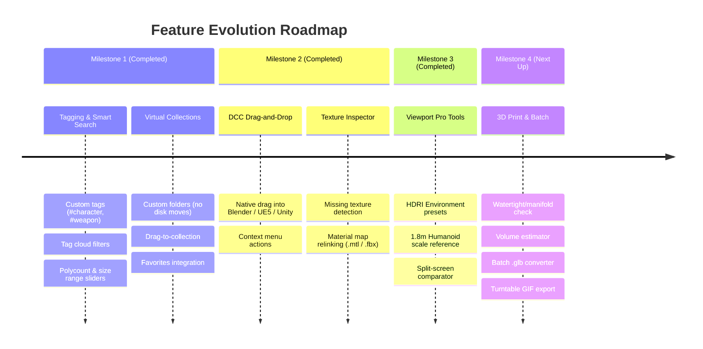

# 3D Model Vault: Product & Engineering Roadmap

**Repository Location**: `E:\Repo\3DModelViewer`  
**Current Version**: `v1.3.0` (Core Scanning, Tagging & Collections, DCC Drag & Drop, Texture Inspector, Viewport Pro Tools & Split-Screen Comparator)

---

## 🗺️ Roadmap Overview

---

## 📌 Milestone 1: Tagging, Collections & Smart Organization
*Status: ✅ Complete*

### 1.1 Custom Tagging System
- **Tag Assignment**: Add or remove tags directly from model cards and inspector drawer.
- **Sidebar Tag Cloud**: A dedicated tags section in the sidebar with live counts per tag.
- **Persistence**: Stored in `AssetStore` with persistent disk storage.

### 1.2 Virtual Collections & Albums
- **Custom Collections**: Group models into virtual projects without altering physical files.
- **Management UI**: Create, delete collections with custom palette colors in the sidebar.
- **Toggle Assignment**: Fast multi-collection assignment from cards and 3D viewer.

---

## 🚀 Milestone 2: DCC & Game Engine Integration
*Status: ✅ Complete*

### 2.1 Native Drag-and-Drop Export
- **Seamless DCC Import**: Drag any model card directly from Model Vault 3D into:
  - **Blender 3D Viewport** (imports mesh directly).
  - **Unreal Engine 5 Content Browser** (triggers asset import dialogue).
  - **Unity Project Window** (imports into active Assets folder).
  - **Windows Explorer / Desktop** (copies file on drop).
- **Implementation**: Electron `webContents.startDrag({ file: absPath, icon: dragIcon })` with high-contrast grip affordance.

### 2.2 Texture & Dependency Inspector
- **Dependency Parser**: Reads external texture references for `.obj` (via `.mtl`), `.gltf` (JSON + images), `.fbx` (ASCII/binary scan), and companion texture folders (`electron/textureInspector.ts`).
- **Live Status Badges**: Real-time status indicators (🟢 Found / 🔴 Missing / 🟣 Embedded) and live badge in the 3D viewer top bar.
- **"Relink Textures" Helper**: Folder scanner resolves missing textures by filename, updates references, copies them into `<model>/textures/`, and hot-reloads the 3D model!
- **MTLLoader Integration**: `.obj` models now parse companion `.mtl` materials directly in Three.js.

### 2.3 Context Menu Quick Actions
- Right-click or `...` button triggers studio dark context menu:
  - *"Open in Blender"*
  - *"Open in Default App"*
  - *"Reveal in Explorer"*
  - *"Inspect Textures & Maps"*
  - *"Add / Remove from Collection"*
  - *"Copy File Path"* / *"Copy Model Name"*
  - *"Toggle Favorite"*

---

## 🎨 Milestone 3: 3D Viewport Pro Tools
*Status: ✅ Complete*

### 3.1 Studio HDRI & Lighting Presets
- **Lighting Presets**:
  - **Studio Neutral**: Three-point studio lighting with key, fill, and back rim lighting.
  - **Cyberpunk Neon**: High-contrast dual-tone palette (cyan key, magenta/violet fill, deep electric blue ambient).
  - **Sunset Golden Hour**: Warm low-angle golden directional sun with cool lavender fill.
  - **Outdoor Daylight**: High-noon sunny daylight with soft blue atmospheric hemisphere fill.
- **Backdrop & Themes**: Dark Slate, 18% Neutral Studio Gray (photometric calibration), Pure White, and OLED Black.
- **Ground Plane Grid**: Dynamic grid with meter sub-divisions and smooth floor shadow contact.

### 3.2 Humanoid Scale & Metric Measurement Guides
- **1.80m Human Silhouette**: Procedural translucent anatomical mannequin positioned next to the model with head, torso, limbs, height ruler, and billboard height badge for instant proportion and scale verification.
- **Metric Bounding Box Guide**: Live dimension wireframe and 3D labels with on-the-fly unit conversion (`m`, `cm`, `mm`, `ft`).

### 3.3 Split-Screen Model Comparator
- **Dual Synchronized Viewports**: Side-by-side inspection for LOD testing, high-to-low poly comparison, and topology audit.
- **Zero-Latency Cross-Viewport Camera Sync**: OrbitControls `'change'` synchronization keeping pitch, yaw, roll, target, and zoom locked in 1:1 sync across both viewports.
- **Technical Mesh HUD**: Triangle count, vertex count, dimensions, file size, and automatic **$\Delta\%$ Triangle Difference pill** (e.g. `+145.2% tris` or `-62.4% tris`).
- **Independent Shading Modes**: Compare Textured vs Wireframe, Clay vs Normals, etc. side-by-side.

### 3.4 Viewport Performance & Loading Engine
- **Deterministic `.glb` Conversion Cache**: Blender CLI conversions now hash the `.blend` file path, size, and `mtimeMs`. Reopening `.blend` files is instantaneous (<1ms) instead of repeatedly invoking a 3–10s headless Blender process.
- **Deep WebGL GPU Resource Disposal**: `disposeThreeScene` thoroughly disposes geometries, textures, materials, and triggers `renderer.forceContextLoss()`. Eliminates WebGL context thrashing, VRAM accumulation, and unmount lag when closing or switching models.
- **Enhanced Studio Loading Screen**: Animated dual-ring cyber spinner with keyframe rotation, sliding progress track, and live stage status text ("Reading model data", "Converting Blender scene", "Parsing 3D geometry & materials").

---

## ⚙️ Milestone 4: 3D Printing & Batch Utilities
*Status: ⏳ Next Up*
*Target: Maker tools, optimization, and sharing*

### 4.1 3D Print Readiness Checker
- **Manifold Verification**: Automatically checks `.stl` and `.obj` files for watertightness and non-manifold edges.
- **Volume & Weight Calculation**: Estimates model volume ($cm^3$) and material weight in grams (PLA, PETG, Resin).
- **"Send to Slicer"**: One-click export to Cura, PrusaSlicer, or Bambu Studio.

### 4.2 Batch Format Converter & Optimizer
- Batch export selected models to `.glb` with Draco mesh compression.
- Batch decimate modifier via headless Blender.

### 4.3 Turntable GIF & Video Exporter
- Offscreen 360° turntable recorder: exports 60fps MP4 or animated GIF for portfolio or sharing on Discord/ArtStation.
